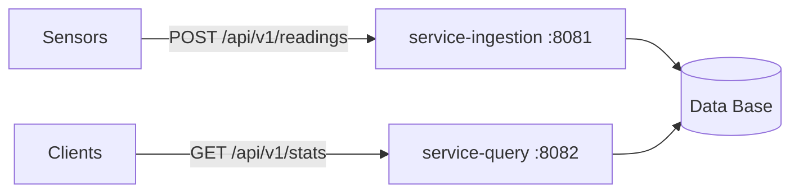

# [POC] Weather Sensor Service

REST API that receives weather readings from sensors and returns statistics (min, max, sum, avg) over a date range. Java 21, Spring Boot, PostgreSQL.



## Prerequisites

| Needed for | Tool |
|---|---|
| Running the app | Docker with the Compose plugin (`docker compose version`). On Linux, your user must be able to run `docker ps` without `sudo`. |
| The examples and the smoke test | `curl`, `jq` and bash (Git Bash or WSL on Windows) |
| Running the tests with `./mvnw` | JDK 21 (`java -version` and `javac -version` must show 21). `JAVA_HOME` must point to it, or be unset with JDK 21 on the `PATH`. |

The app itself needs no Java on the host, because Docker builds and runs it. On Debian or Ubuntu: `sudo apt install openjdk-21-jdk curl jq`.

The first build needs internet access (Maven dependencies and Docker images), and the host ports 5432, 8081 and 8082 must be free.

## Run

```bash
docker compose up --build -d
```

This starts three containers: `db` (127.0.0.1:5432), `service-ingestion` (8081) and `service-query` (8082). Health: `http://localhost:8081/actuator/health` and `http://localhost:8082/actuator/health`.

__Notes:__
- Database credentials: local-only placeholder defaults are built into `docker-compose.yml`; you can override them with a git-ignored `.env` file or exported variables.

- Follow the logs: `docker compose logs -f` (Ctrl+C stops following, not the containers).

- Stop and delete data: `docker compose down -v`

- On Windows, run the commands in Git Bash or WSL (the smoke script is bash).

## Try it

```bash
# Post a reading (the API answers 201 with an empty body, so nothing is printed)
curl -X POST localhost:8081/api/v1/readings -H "Content-Type: application/json" \
  -d "{\"sensorId\":\"s1\",\"timestamp\":\"$(date -u +%Y-%m-%dT%H:%M:%SZ)\",\"metrics\":{\"temperature\":21.5,\"humidity\":60}}"
```

```bash
# Check the stored rows directly in the database
docker compose exec db sh -c 'psql -U "$POSTGRES_USER" -d weather -c "SELECT sensor_id, metric, value, recorded_at FROM readings ORDER BY id DESC LIMIT 5;"'
```
<details>
<summary>db output</summary>
```
 sensor_id |   metric    | value |      recorded_at       
-----------+-------------+-------+------------------------
 s1        | humidity    |    60 | 2026-10-22 09:12:12+00
 s1        | temperature |  21.5 | 2026-10-22 09:12:12+00
(2 rows)
```
</details>
<br>

```bash
# Query with no range (default: last 24 hours, average, all sensors)
curl -s "localhost:8082/api/v1/stats?metrics=temperature,humidity" | jq
```
<details>
<summary>no range query output</summary>

```json
{
  "stat": "avg",
  "from": "2026-10-21T09:16:16Z",
  "to": "2026-10-22T09:16:16Z",
  "results": [
    { "sensorId": "s1", "metric": "humidity", "value": 60.0, "count": 1 },
    { "sensorId": "s1", "metric": "temperature", "value": 21.5, "count": 1 }
  ]
}
```
</details>
<br>

```bash
# Average temperature and humidity for sensor s1 in the last week
curl -s "localhost:8082/api/v1/stats?sensorIds=s1&metrics=temperature,humidity&from=$(date -u -d '7 days ago' +%Y-%m-%dT%H:%M:%SZ 2>/dev/null || date -u -v-7d +%Y-%m-%dT%H:%M:%SZ)" | jq
```
<details>
<summary>last week query output</summary>

```json
{
  "stat": "avg",
  "from": "2026-10-15T09:16:46Z",
  "to": "2026-10-22T09:16:46Z",
  "results": [
    { "sensorId": "s1", "metric": "humidity", "value": 60.0, "count": 1 },
    { "sensorId": "s1", "metric": "temperature", "value": 21.5, "count": 1 }
  ]
}
```
</details>
<br>

The last query sends only `from`; `to` defaults to now. Add `stat=min|max|sum|avg` to change the statistic, or `to=` for an explicit end (for example `2026-10-19T00:00:00Z`).

## API

**POST /api/v1/readings**: `sensorId` (1-64 chars: letters, digits, `.`, `_`, `-`), `timestamp` (ISO-8601 UTC, at most 5 min in the future), `metrics` (1-50 entries; names are `snake_case`; values are numbers). A repeated sensor + metric + timestamp is ignored (first write wins) and still returns 201.

**GET /api/v1/stats**: `metrics` (required, comma-separated), `sensorIds` (optional; omitted means all), `stat` (`min|max|sum|avg`, default `avg`), `from` (inclusive) and `to` (exclusive), both optional.

| Given | Used |
|---|---|
| neither | last 24 h |
| `from` only | `from` to now |
| `to` only | `to` minus 24 h to `to` |
| both | as given |

The range must be 24 h to 31 d. The response echoes the resolved `from` and `to`. No data outputs 200 with an empty `results` list.

Invalid input returns 400 (500 for unexpected errors). Example body:
```json
{"timestamp":"...","status":400,"error":"Bad Request","message":"...","details":[]}
```

## Tests

Run from the repository root. Docker must be running for the integration tests (they start a real PostgreSQL with Testcontainers).

| What | Command |
|---|---|
| Unit and integration tests | `./mvnw test` |
| Unit tests only | `./mvnw test -Dtest='!*IntegrationTest' -Dsurefire.failIfNoSpecifiedTests=false` |
| Integration tests only | `./mvnw test -Dtest='*IntegrationTest' -Dsurefire.failIfNoSpecifiedTests=false` |
| One test class | `./mvnw test -Dtest=StatsServiceTest -Dsurefire.failIfNoSpecifiedTests=false` |
| One test method | `./mvnw test -Dtest='StatsServiceTest#noRangeDefaultsToLast24Hours' -Dsurefire.failIfNoSpecifiedTests=false` |
| One service only | `./mvnw test -pl service-query -am` (or `-pl service-ingestion -am`) |
| One service, unit tests only | `./mvnw test -pl service-query -am -Dtest='!*IntegrationTest' -Dsurefire.failIfNoSpecifiedTests=false` |
| End to end, with the services up | `./scripts/smoke-test.sh` (last line: `PASS all checks`) |

Integration test classes end in `IntegrationTest`, which is what separates them from the unit tests. The `failIfNoSpecifiedTests` flag is needed because the `common` module has no tests of its own.

## Assumptions
- any valid sensor id is accepted, and a query with no matching data returns 200 with an empty list.
- `stat` defaults to `avg` and applies to all requested metrics.
- "Between one day and a month" is read as 24 hours to 31 days (31 covers every calendar month). `from` is inclusive and `to` is exclusive.
- If no date range is given, the statistic covers the last 24 hours.
- The sensor supplies the timestamp (UTC). Metric names are free-form, with no units.
- A reading with the same sensor, metric and timestamp as an existing one is ignored (first write wins).
- Linux or macOS environment (on Windows, use Git Bash or WSL)

## Limitations and not included
- no authentication or rate limiting.
- the services share one database.
- aggregates are computed on demand from raw rows (no caching).
- timestamps are only checked against the future (5 minutes ahead); there is no limit on how old a reading can be, and the 5-minute tolerance is fixed, not configurable.
- minimal configuration: only the database connection can be overridden by environment variables. Ports, the database name and the validation limits (range, timestamp tolerance, field sizes) are fixed in the code or `application.yaml`.
- no Swagger UI / generated OpenAPI docs; this README is the API documentation.
- test coverage is not complete - the tests focus on the validation rules and the SQL; no coverage tool is configured.
- the smoke script is a fast end-to-end check, not an exhaustive E2E suite (no failure, restart or load scenarios).
- no static code analysis or linters.
- no CI/CD setup
- no Makefile or PowerShell scripts.
